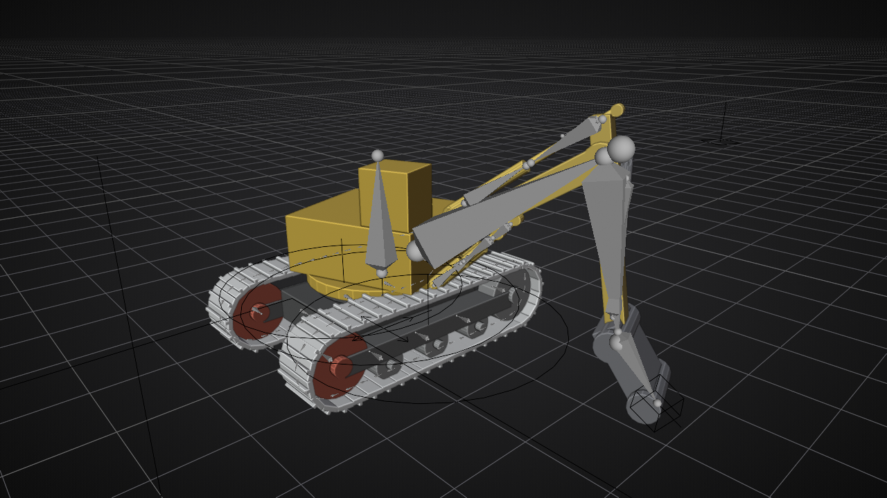
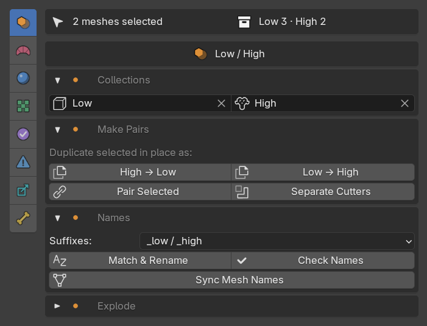

# Pre-Flight

A Blender add-on that gets low and high poly meshes ready to bake, checks them for the
problems that spoil a bake, and rigs hard-surface models such as vehicles and machines.



- **Blender:** 4.2 or newer
- **Works with:** Substance Painter, Substance Designer, Marmoset Toolbag, Fyr Baker,
  Blender and xNormal
- **Author:** Jordan Moss
- **Licence:** GPL-3.0-or-later

**New here? Read the [User Guide](docs/USER_GUIDE.md).** It explains every tab and tool
in plain language, with pictures.

## Contents

- [Install](#install)
- [Quick start](#quick-start)
- [What's in the panel](#whats-in-the-panel)
- [Features](#features)
- [Optional add-ons](#optional-add-ons)
- [Upgrading from Bake Prep](#upgrading-from-bake-prep)
- [For developers](#for-developers)

## Install

1. Download `preflight-<version>.zip` from the
   [Releases](https://github.com/jmossymoss/Pre-Flight/releases) page. Don't unzip it.
2. In Blender, open **Edit > Preferences > Get Extensions**.
3. Click the arrow at the top right and choose **Install from Disk**, then pick the zip.
   Dragging the zip into the Blender window works too.

The panel is in the 3D View sidebar: press **N** and click the **Pre-Flight** tab.

## Quick start

1. **Low / High:** pick your Low and High collections, then press **Match & Rename**.
2. **Baker:** pick the baker you use.
3. **Shading:** set the map size under Textures.
4. **UVs:** offset mirrored copies with **Mirror +1U**, then **Pack Selected**.
5. **Checks:** press **Full Prep**, then **Validate**, **Names** and **Projection**.
6. **Issues:** press **Fix All**, then fix what's left by hand.

## What's in the panel



A tab strip runs down the left side of the panel. Each tab is one page:

| Tab | What it's for |
| --- | --- |
| **Shading** | Hard edges, triangulation, custom normals, and loading baked textures |
| **UVs** | Mirrored copies, packing, stacking and texel density |
| **Low / High** | Collections, pairing, naming, explode and the engine mesh |
| **Baker** | Presets for each baker, and ID colours |
| **Rigging** | Bones, hinges, pistons, gears, chains, tracks, wheels and game export |
| **Checks** | Full Prep and the checks that look for bake problems |
| **Issues** | The list of what the checks found, with fixes |

## Features

### Shading

- **Hard Edges from UVs:** marks sharp edges along UV seams or island borders. Mirror
  lines stay soft.
- **Triangulate:** adds a Triangulate modifier so the baker and the engine split quads
  the same way.
- **Custom Normals:** clears custom normals that override sharp edges.
- **Textures:** sets the map size, per scene or per material. Loads maps exported from
  Substance Painter (every default preset, UDIMs included), reloads them, watches the
  folder for re-exports, and flips a normal map's green channel.

### UVs

- **Mirror / Array Copies:** offsets the copies one tile (+1U) for baking, with an
  overlay showing which are done.
- **Packing:** packs with UVPackmaster, Zen UV or Blender. Padding follows the map size.
  **Match Map Ratio** handles non-square maps.
- **Stacking:** stacks similar islands, and offsets the copies for the bake.
- **Texel Density:** an overlay, a target, and a button to scale islands to it.

### Low / High

- **Collections:** which collection holds the lows and which the highs.
- **Make Pairs:** duplicates a mesh as its bake partner, or pairs two you already have.
- **Names:** `_low/_high`, `_lo/_hi`, `_lp/_hp` or `_l/_h`. **Match & Rename** pairs
  each high with the low it overlaps most.
- **Explode:** moves pairs apart so neighbours don't bake onto each other, and puts
  them back.
- **Engine Mesh:** copies the lows for the engine with modifiers applied, `_low`
  removed and parts combined. The bake setup isn't touched.

### Baker

- **Preset:** sets Pre-Flight's prep to suit your baker, and lists what to set on the
  baker's side.
- **ID Colors:** flat colours on the highs for an ID map, per object, part or material.

### Rigging

For hard-surface models. Parts stay rigid and move on bones.

**Bones**

- **Mirror Parts:** copies parts to the other side with properly mirrored pivots and
  positive scale.
- **Bones from Origins:** one bone per part on its pivot, chained like the parts, under
  a root. Parts are bound by bone parent, rigid weights, or with their own hierarchy
  kept.
- **Bone from Hinge** and **Origin to Hinge:** take a hinge from an Edit Mode selection.
- **Hinge Limits:** one axis, within a range.
- **IK Chain:** a target and a pole on a chain of bones, such as an excavator arm.

**Mechanisms**

- **Piston:** a cylinder and rod that stay lined up between two mounts.
- **Link Gears:** gears turn together by their size ratio, meshed or chained. With a
  chain or track selected, the active wheel drives it and the other wheels follow.
- **Chains & Tracks:**
  - **Path Around Wheels** wraps a path round the selected wheels.
  - **Calculate Links** works out how many links fit.
  - **Chain Along Curve** builds the chain, one bone per link, driven by a sprocket.
  - **Roll Links** turns the finished links to face the right way.
  - **Instances** builds the chain from linked copies of one editable link.
- **Wheel Spin:** wheels roll by the distance the vehicle really moves. Tracks
  counter-rotate when it spins on the spot.
- **Drive Control:** one bone on the ground to drive and steer with.
- **Bake Wheel Roll:** keys each wheel from its real path, for arcs and loops.

**Finishing**

- **Set Up Controls:** sorts bones into coloured Controls, Mechanism and Deform groups
  and gives each control a shape. **Apply Shape** sets one by hand.
- **Clear Drivers:** removes the drivers the tools added.
- **Check Rig** and **Make Game Ready:** one root bone, a safe name, rigid skinning,
  applied scale, no dependency cycles, and motion baked to keys.

### Checks and Issues

- **Full Prep:** hard edges and triangulation in one click.
- **Validate**, **Names** and **Projection:** look for bake problems, naming slips, and
  rays that miss the high.
- **Issues:** click an issue to isolate and frame it. **Select** picks the problem
  elements, **Fix** or **Fix All** repairs them, and **Ignore** hides the ones you meant.

## Optional add-ons

Pre-Flight works on its own. It uses these when they're installed and enabled:

| Add-on | Used for |
| --- | --- |
| **UVPackmaster 4** | Pack and Stack Similar. Its own panel settings are left alone. |
| **Zen UV** | Pack, Stack Similar and Set Texel Density. |

You can turn either off under **Edit > Preferences > Add-ons > Pre-Flight**. The same
page has the sidebar tab name, overlay colours and the defaults for new files. The
[User Guide](docs/USER_GUIDE.md#preferences) lists them all.

## Upgrading from Bake Prep

Pre-Flight used to be called Bake Prep. Uninstall Bake Prep before installing
Pre-Flight. Files saved with Bake Prep keep all their settings: they're moved to the
new names when the file opens.

## For developers

**Live install.** Link the `preflight` folder into Blender's extensions folder. On
Windows:

```
mklink /J "%APPDATA%\Blender Foundation\Blender\5.2\extensions\user_default\preflight" preflight
```

**Build the zip.** This validates the package and writes it to `dist/`. It finds
Blender from an argument, the `BLENDER` environment variable, or the default Windows
install folder.

```
python tools/build.py
```

**Layout**

```
preflight/               the add-on
  core/                  logic only: checks, UVs, naming, textures, rigging, export
  operators/             the buttons, one module per area
  ui/                    the sidebar panel
  icons/                 icon PNGs
  properties.py          scene, material and window-manager settings
  preferences.py         add-on preferences and new-file defaults
  issues.py              the Issues list
  integrations.py        UVPackmaster 4 and Zen UV
  migrate.py             moves Bake Prep data to Pre-Flight names on load
docs/                    the User Guide and its pictures
tools/                   build.py (package zip), make_icons.py (redraw the icons)
```
