# Pre-Flight User Guide

Pre-Flight is a Blender add-on that gets your low and high poly meshes ready to bake, checks them for problems, exports them, and rigs hard-surface models such as vehicles and machines. This guide covers version 3.5.0, one tab at a time.

## Getting started

### Install

1. Download `preflight-3.5.0.zip`. Don't unzip it.
2. In Blender, open **Edit > Preferences > Get Extensions**.
3. Click the small arrow at the top right and choose **Install from Disk**, then pick the zip. Dragging the zip into the Blender window works too.

Pre-Flight needs Blender 4.2 or newer. If you still have the old Bake Prep add-on, uninstall it first. Files saved with Bake Prep keep all their settings.

### Find the panel

In the 3D View, press **N** to open the sidebar and click the **Pre-Flight** tab on its edge.

### How the panel is laid out

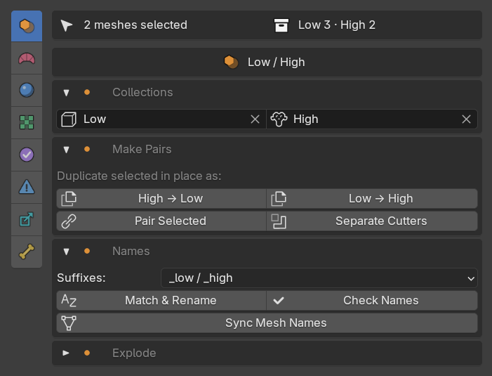

- **The tab strip** runs down the left side of the panel. Each icon is one page, in the order you use them: Low / High, Baker, Shading, UVs, Checks, Issues, Export and Rigging.
- **The summary box** at the top shows how many meshes you have selected, and how many objects are in your Low and High collections.
- **Sections** are the headed blocks on each page. Click a section's heading to fold it away when you don't need it.
- **Hover over any button** to read what it does. Most tools work on whatever you have selected.

### A typical bake job

Work down the tab strip from the top.

1. **Low / High**: tell Pre-Flight which collection holds your lows and which holds your highs.
2. **Baker**: pick the baker you use, so the prep settings suit it.
3. **Shading** and **UVs**: set hard edges and pack your UVs.
4. **Checks**: press **Full Prep**, then **Run All Checks**.
5. **Issues**: fix whatever it found.
6. **Export**: press **Export for Baker**, then bake.

Rigging is a separate job, so its tab sits at the bottom.

## Low / High

Bakers match a low poly mesh to its high poly by name. This page keeps the two sets organised, paired and named, so the baker never matches the wrong parts.

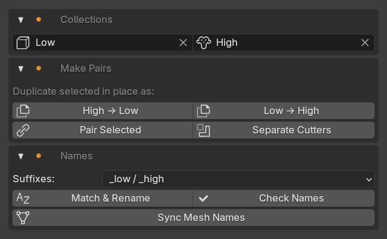

### Collections

Pick the collection that holds your lows and the one that holds your highs. The summary box at the top of the panel then shows how many objects are in each. The checks and the exports use these collections too.

### Make Pairs

- **High → Low** / **Low → High**: duplicates the selected meshes in place as their bake partners. The original and the copy get the same name, ending in `_high` and `_low`.
- **Pair Selected**: you already have both meshes. Select them and they're named as a pair after the active one. The mesh with fewer faces becomes the low.
- **Separate Cutters**: gives the selected objects their own copies of any boolean cutters or helper objects they share with other objects, so editing one doesn't change the other.

### Names

- **Suffixes**: the naming style to use: `_low` / `_high`, `_lo` / `_hi`, `_lp` / `_hp` or `_l` / `_h`.
- **Match & Rename**: pairs each high with the low it overlaps most, and renames both to match.
- **Check Names**: looks for missing partners, mismatched capitals, stray `.001` endings and similar slips. Results go to the Issues page.
- **Sync Mesh Names**: renames each object's mesh data to match the object, which some bakers need.

### Explode

When parts sit close together, one part's high can bake onto its neighbour's low. Exploding moves each pair away from the others for the bake.

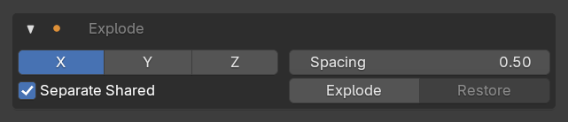

- **X / Y / Z**: the direction to spread the pairs.
- **Spacing**: the gap between pairs.
- **Separate Shared**: if two pairs share a cutter, each gets its own copy so the cuts survive the move.
- **Explode** / **Restore**: move the pairs apart, and put them back exactly where they were.

## Baker

Every baker wants things set up a little differently. Tell Pre-Flight which one you use and it sets itself up to match.

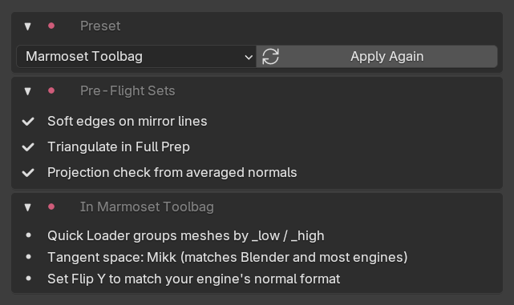

### Preset

Pick your baker: Substance Painter, Substance Designer, Marmoset Toolbag, Fyr Baker, Blender or xNormal. Pre-Flight changes its own prep settings to suit, and the Export page writes the files the way that baker wants them. **Apply Again** puts the settings back if you've changed some since.

### Pre-Flight Sets

The list of settings the preset controls. A tick means the setting still matches the preset. A warning sign means you've changed it.

### In your baker

A short checklist of what to set on the baker's side, such as the tangent space or how it matches names. Pre-Flight can't set these for you, so check them once before you bake.

### ID Colors

An ID map lets you mask parts quickly when texturing. These buttons paint flat, clearly different colours onto your highs, ready for a Color ID bake.

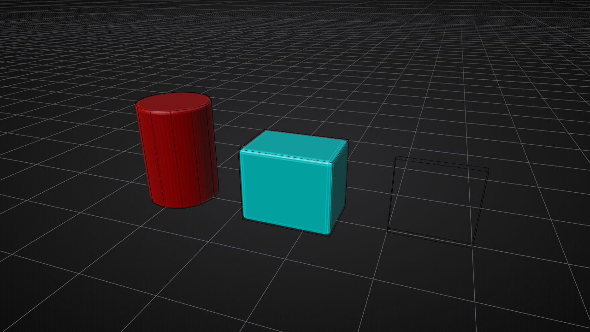

- **Per Object**: one colour for each object.
- **Per Part**: one colour for each separate piece of mesh inside an object.
- **Per Material**: one colour for each material.
- **Clear**: removes the colours again.

## Shading

This page sets up how your low poly is shaded before the bake, and loads the finished textures back in afterwards.

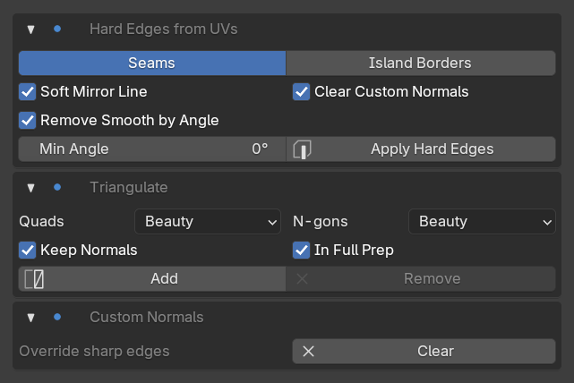

### Hard Edges from UVs

A clean bake wants a hard edge wherever the UVs are split. This section does that for you.

- **Seams / Island Borders**: where to read the splits from. Use **Seams** if you mark seams by hand, or **Island Borders** to use the edges of your UV islands.
- **Soft Mirror Line**: keeps the edge down the middle of a mirrored mesh soft, so there's no visible line.
- **Clear Custom Normals** and **Remove Smooth by Angle**: clear out older shading setups that would override your hard edges.
- **Min Angle**: only harden edges sharper than this. Leave it at 0 to harden every split.
- **Apply Hard Edges**: does it, on the selected meshes.

### Triangulate

Bakers and game engines turn quads into triangles, and they don't always split them the same way. Adding a Triangulate modifier fixes the split, so the bake and the engine agree.

- **Quads** and **N-gons**: how each is split. Beauty is a good default.
- **Keep Normals**: keeps your shading the same after triangulating.
- **In Full Prep**: also add the modifier when you press Full Prep.
- **Add** / **Remove**: add or remove the modifier on the selected meshes.

### Custom Normals

**Clear** removes custom normals from the selected meshes. Use it when imported shading is overriding your sharp edges.

### Textures

Set your map size here, then load your baked textures back onto the model.

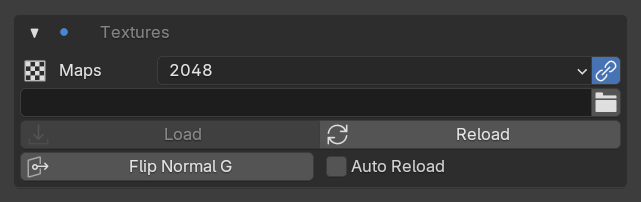

- **Maps**: the texture size for the whole scene, for example 2048. Click the link icon to unlock it and set a width and height that aren't the same.
- **Own Size**: gives the active material its own map size, when one texture set is bigger or smaller than the rest.
- **The folder box**: the folder your textures were exported to.
- **Load**: finds the maps and wires them into your materials. It understands every default Substance Painter export preset, UDIMs included, and the plain names Marmoset Toolbag and Substance Designer write, such as `Body_normal` and `Body_ao`.
- **Reload**: re-reads the files after you export again.
- **Auto Reload**: watches the folder and reloads when files change.
- **Flip Normal G**: flips the normal map's green channel, for when bumps look like dents. If you set **Normals** to DirectX on the Export page, Load does this for you.

## UVs

This page gets your UVs ready to bake: no accidental overlaps, a tidy pack, and even texture detail.

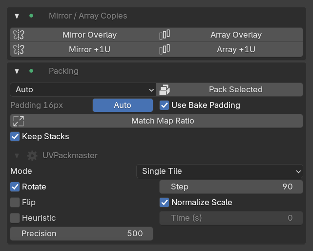

### Mirror / Array Copies

Mirror and Array modifiers make copies that share the same UVs. That's fine in the game, but a baker sees two surfaces on the same pixels and bakes rubbish. The fix is to slide the copies one tile to the right while you bake.

- **Mirror +1U** / **Array +1U**: move the copies made by those modifiers one UV tile to the right.
- **Mirror Overlay** / **Array Overlay**: colours the copies in the viewport. A tick means they're offset, a warning sign means they still overlap.

### Packing

- **The packer dropdown**: which tool packs. Auto picks UVPackmaster or Zen UV if you have them, and Blender's own packer if not.
- **Pack Selected**: packs the selected meshes' UV islands. In Edit Mode it packs just the islands you have selected.
- **Padding**: the gap between islands, in pixels. **Auto** sets it from your map size (16px at 2048), which is safe for mipmaps. With Auto off, the small button beside the number sets it to the suggested value for your map size.
- **Use Bake Padding**: pack with Pre-Flight's padding, not the packer's own margin.
- **Match Map Ratio**: for maps that aren't square. It stretches the islands so pixels stay square.
- **Keep Stacks**: islands you've stacked on top of each other stay stacked.

If you use UVPackmaster, its main settings show up underneath (mode, rotation, heuristic search, precision). They only apply to packs you start from Pre-Flight.

### Stacking

Stacking puts identical islands on top of each other so they share texture space.

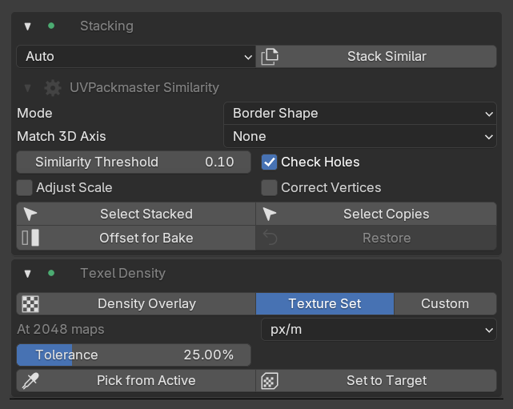

- **Stack Similar**: finds islands with the same shape and stacks them. This needs UVPackmaster or Zen UV.
- **Select Stacked** / **Select Copies**: select the stacked islands, or only the extra copies.
- **Offset for Bake**: moves the extra copies one tile right for baking, leaving one of each in place.
- **Restore**: puts them back afterwards.

### Texel Density

Texel density is how many texture pixels cover a metre of your model. Keeping it even stops one part looking blurry next to another.

- **Density Overlay**: colours the model by density. Blue is too low, green is on target, red is too high.
- **Texture Set / Custom**: compare against the average of the texture set, or against a number you type in.
- **The units dropdown**: pixels per metre, centimetre, millimetre, inch or foot.
- **Tolerance**: how far off an island can be before it's flagged.
- **Pick from Active**: use the active object's density as the target.
- **Set to Target**: scales the selected meshes' islands to the target. Pack again afterwards.

## Checks

This page looks for the problems that spoil a bake, before you find them in the baked maps.

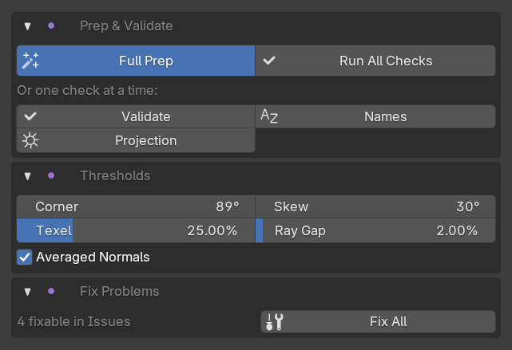

### Prep & Validate

- **Full Prep**: runs the usual prep in one click: hard edges, plus the Triangulate modifier if you've ticked In Full Prep on the Shading page.
- **Run All Checks**: runs every check below in one click, plus Check Rig if a rig is selected or set on the Rigging page.
- **Validate**: checks the selected meshes for common bake problems.
- **Names**: checks low and high names match up.
- **Projection**: fires rays from each low to its high, as a baker does. It flags rays that miss and parts that sit too far from the high, and measures the ray distance the bake needs.

Everything found is listed on the Issues page.

### Thresholds

How strict the checks are.

- **Corner**: flag edges sharper than this that have no UV split.
- **Skew**: flag faces where the shading bends away from the surface by more than this. Details bake slanted there.
- **Texel**: how far an island's texel density can be from the rest.
- **Ray Gap**: how far the high can sit from the low.
- **Averaged Normals**: fire the rays the way most bakers do by default.

### Fix Problems

**Fix All** applies every fix that Pre-Flight can make by itself, then checks again.

### Select Problems

Each button selects one kind of problem on your mesh and switches to Edit Mode, so you can see it and fix it by hand. For example: hard edges with no UV split, n-gons, flipped faces, doubled vertices and loose edges.

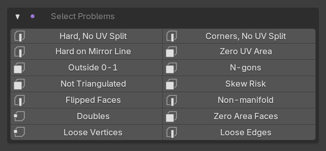

## Issues

The Issues page is the list of everything the checks found. The list is saved with your file, so it's still there when you open the file again.

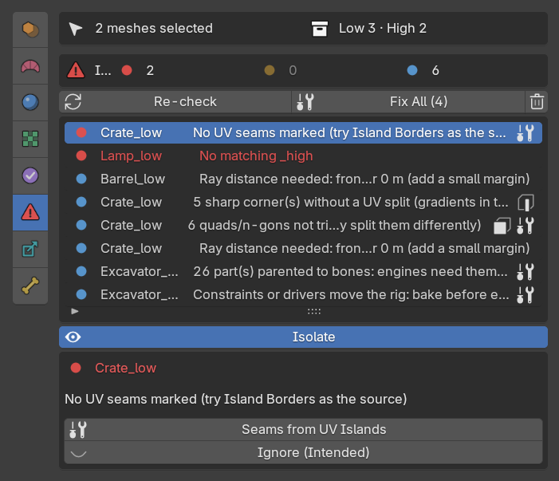

- **The counts at the top** show errors, warnings and notes.
- **Click an issue** to see what it means. With **Isolate** on, the view shows just that object and frames it.
- **The fix button** (such as Seams from UV Islands) repairs that one issue. **Fix All** repairs everything it can.
- **Select** highlights the exact edges or faces at fault.
- **Ignore (Intended)**: for things you did on purpose. The issue is greyed out and no longer counted, even when you check again.
- **Re-check** runs the last checks again. The bin clears the list.

Red entries are errors that will spoil the bake. The others are warnings and notes worth a look.

## Export

This page writes the files: the low and high for your baker, and the finished model for your game engine.

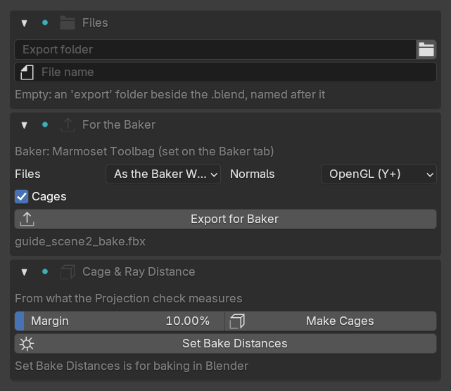

### Files

- **Export folder**: where the files go. Leave it empty and they go in a folder called `export` beside your .blend file.
- **File name**: what the files are called. Leave it empty to use the .blend's name.

### For the Baker

**Export for Baker** writes your low and high meshes as FBX, with modifiers applied. It uses the Low and High collections, or the selected meshes named `_low` and `_high`.

- **Files**: **As the Baker Wants** writes two files (`name_low.fbx` and `name_high.fbx`) for Substance Painter, Substance Designer and xNormal, and one file (`name_bake.fbx`) for Marmoset Toolbag. You can also pick one or two files yourself. Fyr Baker and Blender bake inside Blender and need no files.
- **Normals**: the normal map format you bake to. Choose **DirectX** if your engine uses it (Unreal does). Load Textures then flips the green channel, so the maps look right in Blender.
- **Cages**: also writes any cages you've made, to `name_cage.fbx`.

The line under the button shows the file names it will write.

### Cage & Ray Distance

A baker needs to know how far to look for the high poly. These buttons work it out from your meshes, using the same measurement as the Projection check.

- **Make Cages**: makes a cage for each low: a copy pushed out until it just clears the high. Cages go in their own collection and are replaced each time.
- **Margin**: extra distance added on top, as a safety gap.
- **Set Bake Distances**: for baking in Blender. It sets Extrusion and Max Ray Distance in Blender's own bake settings.

### For the Engine

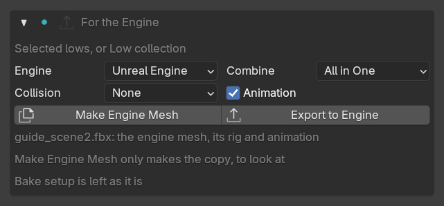

**Export to Engine** makes a clean copy of your lows and writes it for your game engine, along with its rig and animation if it has them. It works on the selected lows, or on the whole Low collection if nothing is selected.

- **Engine**: Unreal Engine (FBX), Unity (FBX) or Godot (glTF). Each gets the scale and settings it expects.
- **Combine**: join everything into one mesh, one mesh per texture set, or one per parent.
- **Collision**: adds a simple collision shape for each mesh that isn't rigged: a box or a convex hull. They're named the way each engine picks them up on import.
- **Animation**: includes the rig's animation over the scene's frame range.
- **Make Engine Mesh**: only makes the copy, without writing a file, so you can look at it first. The copy has modifiers applied and `_low` removed from the names.

Your bake setup isn't touched. Making a new copy replaces the last one.

## Rigging

The Rigging page is for hard-surface models: vehicles, machines, robots, doors. Parts stay rigid, so nothing bends or stretches. Each tool does one job, and you can stack them up to rig a whole machine.

The page is split in three, with buttons at the top: **Bones**, **Mechanisms** and **Finish**. The pictures below show each tool at work on a small example.

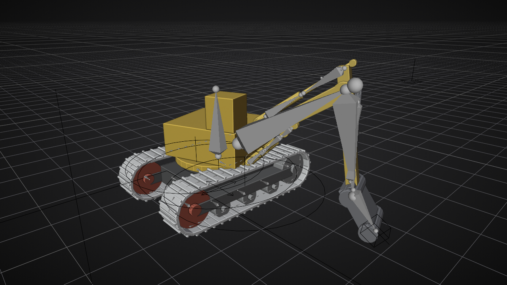

### Rig

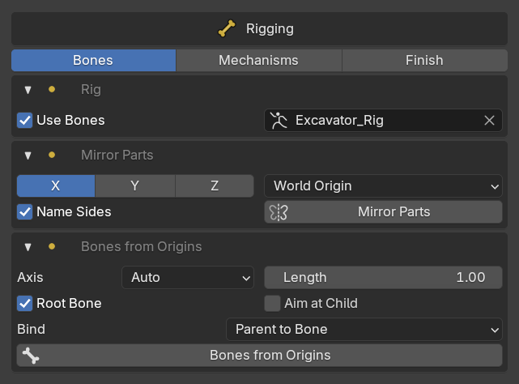

- **Use Bones**: on, the tools build on an armature, which is what game engines need. Off, they build from the parts themselves. See "Rigging without bones" at the end of this section.
- **The rig box**: the armature the tools add bones to. Leave it empty and **Bones from Origins** makes one for you. Pick a rig here if you want the tools to add to one you already have.

### Mirror Parts

Copies parts to the other side of the model, the right way. A plain mirror leaves the copy with negative scale, which breaks bones and game engines. Mirror Parts gives the copy a properly mirrored pivot and positive scale.

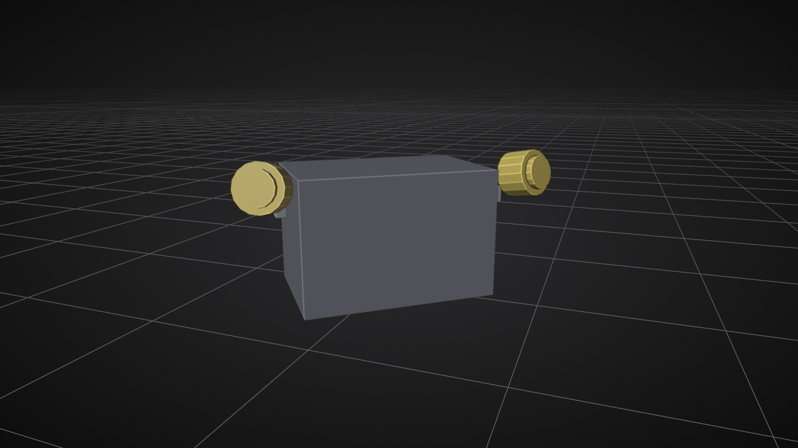

- **X / Y / Z**: the axis to mirror across.
- **The pivot dropdown**: what to mirror around, such as the world origin or the 3D cursor.
- **Name Sides**: adds `_L` and `_R` to the names.

### Bones from Origins

The main rigging button. Select your parts and it adds one bone for each, sitting on the part's origin (its pivot point). If your parts are parented to each other, the bones are chained the same way.

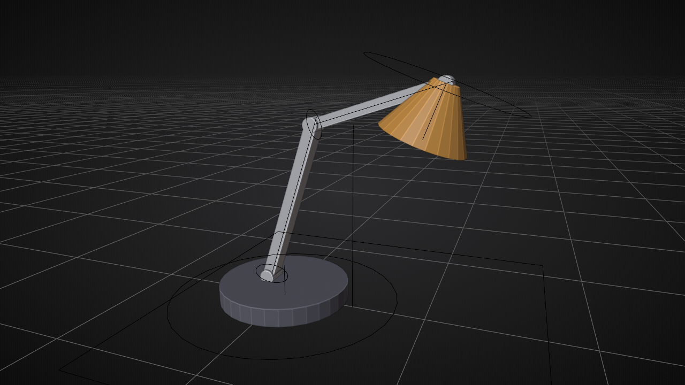

- **Axis**: which way each bone points. **Auto** points it along the part, towards the end that sticks out furthest. Left and right wheels both point inwards.
- **Length**: 1.00 makes each bone run the full length of its part.
- **Root Bone**: adds one bone on the ground under everything, to move the whole rig.
- **Aim at Child**: points each bone at the next part in the chain.
- **Bind**: how parts follow their bones. **Parent to Bone** is the simplest. **Rigid Weights** skins each part fully to its bone, which is what game engines want. **Keep Hierarchy** leaves your own parenting alone.

### Hinges

For anything that swings on a pin: lids, doors, flaps, digger arms.

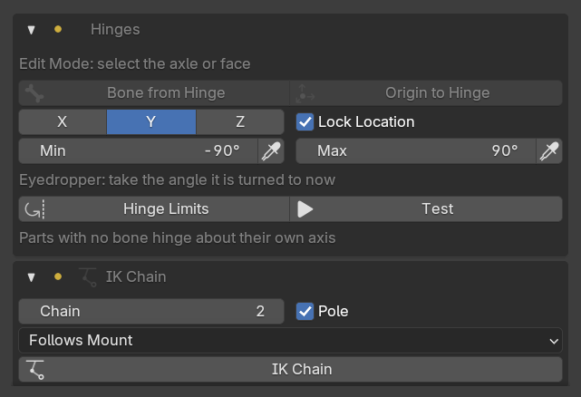

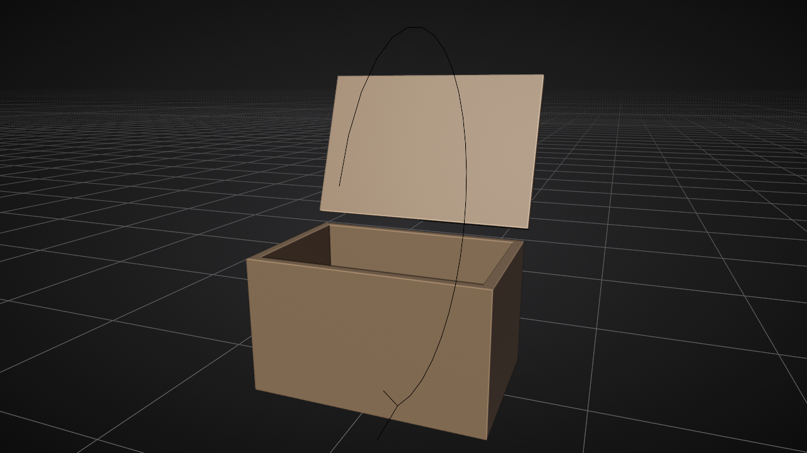

- **Bone from Hinge**: in Edit Mode, select the hinge itself (two points on the axle, a ring of edges, or a face). This adds a bone right on the hinge, pointing along it.
- **Origin to Hinge**: moves the part's origin onto the hinge without moving the mesh. Use this first when you plan to press Bones from Origins afterwards.
- **Hinge Limits**: makes a bone a true hinge. It turns on one axis only (**X / Y / Z**) and stops at **Min** and **Max**. **Lock Location** stops it sliding. A part that has no bone becomes a hinge itself.
- **The eyedroppers**: turn the part as far as it should go, then click the eyedropper beside Min or Max. It takes the angle from where the part is now, so you don't have to guess numbers.
- **Test**: swings the hinge through its limits and puts it back, so you can see the result.

### IK Chain

Lets you drag the end of an arm and have the joints follow, as on an excavator or robot arm.

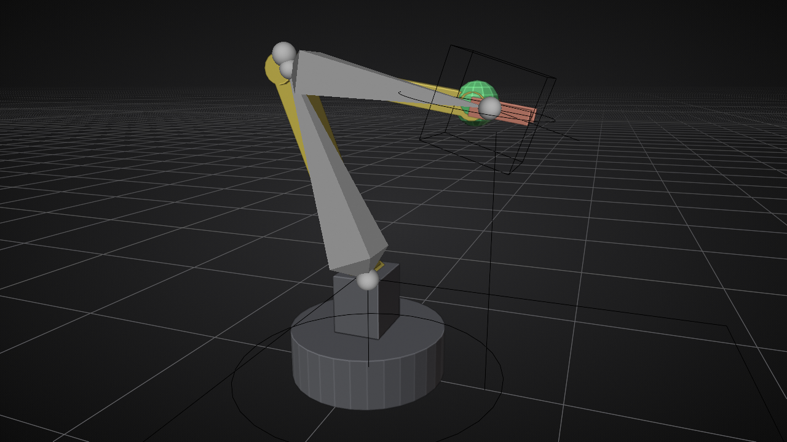

- **Chain**: how many bones the arm has.
- **Pole**: adds a handle to steer the elbow.
- **The dropdown**: what the target rides on, so the reach turns with the machine.

Hinge Limits you've set are respected. IK needs bones.

### Reading the Mechanisms page

The tools on the Mechanisms page care which object you select last. To save you remembering, a line above each button says what your selection would be to that tool, such as "Driver: GearA | Follow: GearB". If the line shows a hint in grey, the selection doesn't fit that tool yet.

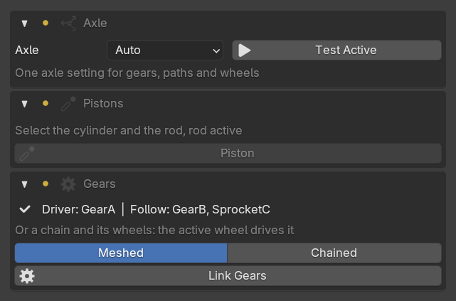

- **Axle**: the axis a gear, sprocket or wheel turns about. One setting covers gears, paths and wheels. **Auto** works it out from each part's shape; set it by hand only if Auto guesses wrong.
- **Test Active**: plays the active part's motion and puts it back. A hinge swings through its limits, a vehicle drives forward and back, and anything else turns once. Test a part that is driven and it turns whatever drives it. Press Esc or click to stop early.

### Pistons

For hydraulic rams and anything else that slides in and out between two mounts.

Select the cylinder and the rod, with the rod active (selected last), and press **Piston**. Each half gets a bone on its pivot that always points at the other half. Move either mount and the ram stays lined up and telescopes by itself.

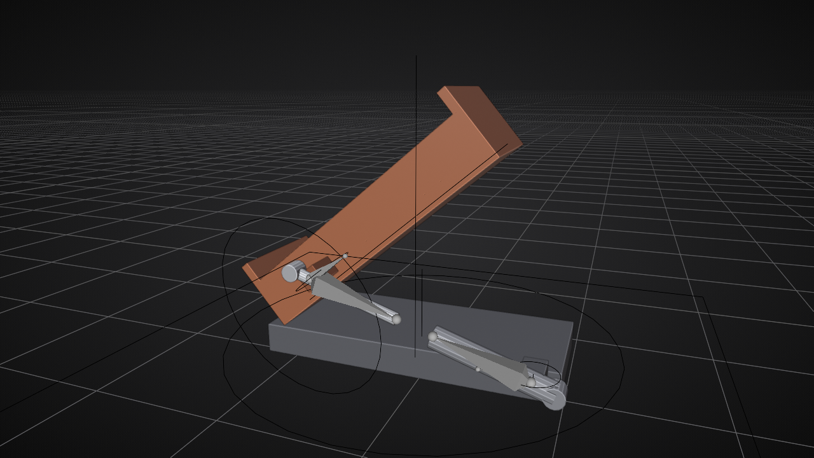

### Gears

**Link Gears** makes wheels turn together.

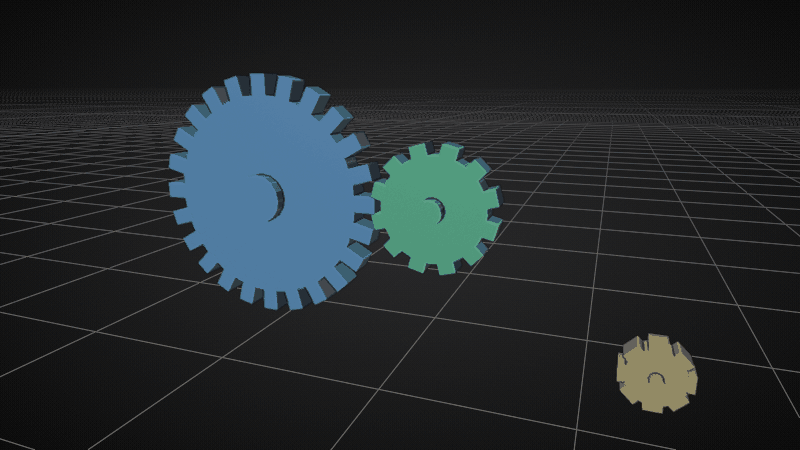

- Select the gears, with the one that drives selected last, then press **Link Gears**. Turn the driving gear and the others follow, faster or slower by their size.
- **Meshed**: gears that touch. The driven gear turns the opposite way.
- **Chained**: sprockets joined by a chain or belt. They turn the same way.

It also works with a chain or track made by Chain Along Curve. Select the chain and its wheels:

- **A wheel is active**: that wheel drives the chain, and the other wheels turn with it.
- **The chain is active**: the wheels follow the chain, whatever is driving it.

### Chains & Tracks

Builds a chain, belt or tank track out of one link. Work down the section from top to bottom.

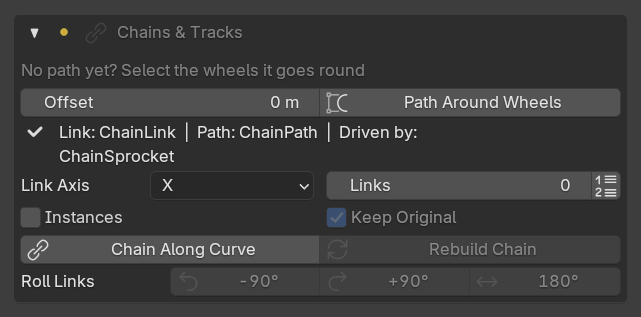

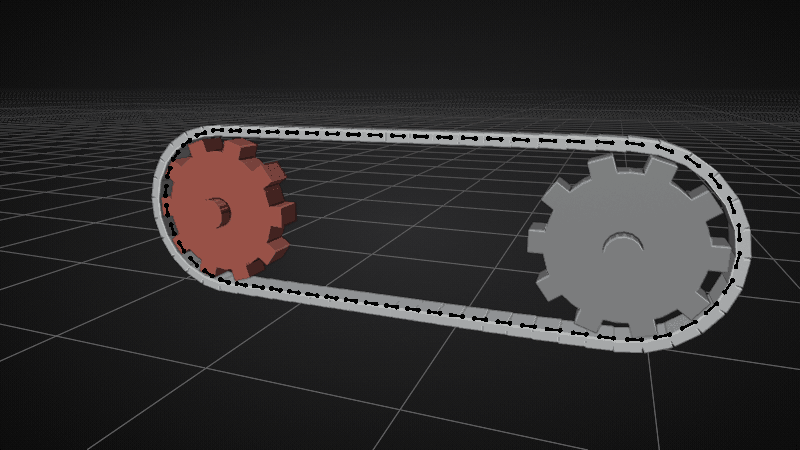

1. **Make the path.** Select the wheels the chain goes round and press **Path Around Wheels**. It draws a closed path round them, the way a real chain sits. **Offset** pushes the path out from the wheel rims, so links sit on the teeth and not in them. You can also draw your own curve.
2. **Count the links.** Select the link and the path, then click the small button next to **Links**. It measures the link and the path and fills in the number that fits best. **Link Axis** is the direction of the link that runs along the chain.
3. **Build it.** Select the link, the path and, if you have one, the sprocket that drives it. Press **Chain Along Curve**. Every link gets its own bone, and turning the sprocket runs the chain.
4. **Fix the facing.** If the links come out standing up or upside down, use **Roll Links**: −90°, +90° or 180°. You can press it as often as you like.

Two options change what is built:

- **Instances**: each link is its own object sharing one mesh, so the chain stays editable. Off, the chain is a single skinned mesh, which is what a game engine wants.
- **Keep Original**: with Instances on, the link you modelled stays where it is. Edit its mesh in Edit Mode and every link on the chain changes with it.

Changed your mind afterwards? Select the chain, set **Links** or **Instances** to what you want, and press **Rebuild Chain**. It builds the chain again on the same path and keeps its roll, what drives it and the wheels that turn with it.

### Wheels & Driving

Makes wheels roll by the right amount when the vehicle moves, so they never slide.

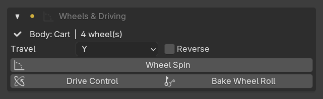

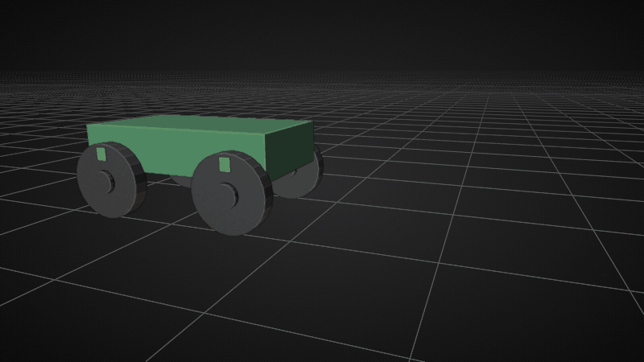

- **Wheel Spin**: select the wheels, then the vehicle body last, and press it. Move the body and each wheel turns by the distance travelled. Small wheels turn faster than big ones. Tracks built with Chain Along Curve come along with the body.
- **Travel**: the body's forward axis.
- **Reverse**: tick this if a wheel rolls backwards.
- **Drive Control**: adds one bone on the ground under the vehicle. Move and turn it to drive. On a turn, the left and right sides roll by their own share, so tank tracks counter-rotate when spinning on the spot.
- **Bake Wheel Roll**: turns the rolling into keyframes over your animation, following the real path the vehicle took. Use it for long curves, loops and reversing. It's greyed out until some wheels have Wheel Spin.

### Built So Far

A list of every mechanism the tools have built in the scene: drive controls, wheels, chains, gear links, pistons, IK and hinges. Each row says what drives what.

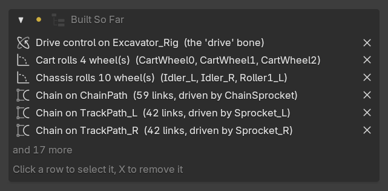

- **Click a row** to select its parts.
- **Click the X** to remove it. This takes away what the tool added (drivers, constraints, helper bones, a chain's links) and leaves your parts alone.

If something isn't moving, look here first. A chain that says "nothing drives it" needs a sprocket: select the chain and a wheel, wheel last, and press Link Gears.

### Drivers

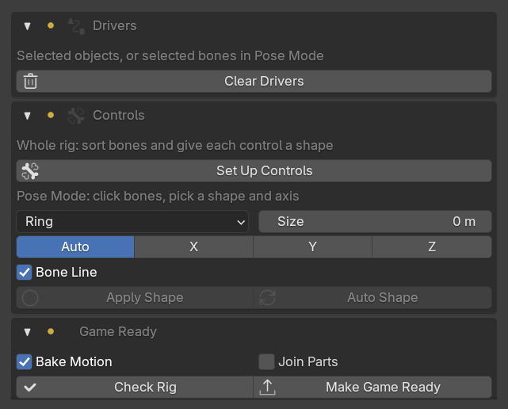

The gear, wheel and chain tools work by adding drivers, which are small rules that say "this turns when that turns". **Clear Drivers** removes every driver from the selected objects, so you can start a link again. In Pose Mode it only clears the selected bones. To remove just one mechanism, use the X in Built So Far.

### Controls

Makes the rig pleasant to animate.

- **Set Up Controls**: sorts the rig's bones into three coloured groups (Controls, Mechanism and Deform) and gives each control a shape sized to its part. Bones you animate get clear shapes. Bones that only do background work are tucked away.
- **Apply Shape**: in Pose Mode, select bones and give them a shape of your choice: Ring, Rotate, Square, Arrows, Diamond, Cross, Cube or Sphere.
- **Size**: the shape's radius. Leave it at 0 to size it to the part.
- **Auto / X / Y / Z**: which way the shape faces.
- **Bone Line**: keeps a line showing where the bone itself runs.
- **Auto Shape**: puts the selected bones back to the shape Set Up Controls would pick.

Shapes you set by hand are kept when you run Set Up Controls again.

### Game Ready

Game engines are fussy about rigs. These buttons find and fix what they reject.

- **Check Rig**: lists problems on the Issues page, such as more than one root bone, parts that would bend, scale that isn't applied, and loops where bones depend on each other.
- **Make Game Ready**: fixes the rig for export. It gives it one root bone and a safe name, and skins each part rigidly to its bone.
- **Bake Motion**: also turns everything the drivers and constraints do into plain keyframes, which is all an engine can read.
- **Join Parts**: also joins the parts into one mesh.
- **Make Rigid**: gives every vertex of the selected meshes full weight to one bone, so rigid parts stop bending.

When the rig is ready, go to the Export page and press **Export to Engine**.

### Rigging without bones

If the model is only for renders or animation inside Blender, you don't need an armature. Turn **Use Bones** off at the top of the Rigging page and the tools build from your parts and a few empties.

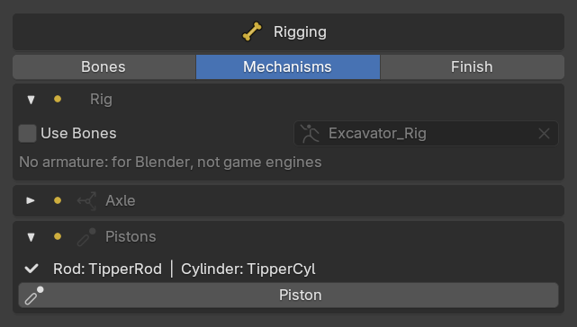

- **Gears** and **Wheel Spin** work on parts as they are, with or without bones.
- **Hinge Limits** makes the part itself a hinge about its own axis. A part with no parent is hung from a small empty that holds its resting angle.
- **Piston** hangs each half from an empty that points at the other half.
- **Chain Along Curve** makes each link an object that follows the path by itself. A chain without bones is always made of instances.
- **Drive Control** adds an arrow empty on the ground and hangs the vehicle body from it. Wheel Spin hangs the wheels on the body so they come along.

IK Chain, Controls and Game Ready need bones. A rig without bones can't go to a game engine, so leave Use Bones on for anything you'll export.

## Recipes

Short walkthroughs for common jobs.

### Get a model ready to bake

1. On **Low / High**, pick your Low and High collections.
2. Press **Match & Rename** so every low has a matching high.
3. On **Baker**, pick the baker you use.
4. On **Shading**, set the map size under Textures.
5. On **UVs**, press **Mirror +1U** if you use Mirror modifiers, then **Pack Selected**.
6. On **Checks**, press **Full Prep**, then **Run All Checks**.
7. On **Issues**, press **Fix All**, then deal with what's left by hand.
8. If parts sit close together, press **Explode** on Low / High.
9. On **Export**, press **Make Cages** if your baker uses them, then **Export for Baker**.
10. Press **Restore** on Low / High to put exploded parts back.

### Rig a lid or door

1. Select the lid and go into Edit Mode.
2. Select the hinge: two points along it, or the face it sits on.
3. Press **Bone from Hinge**.
4. Turn the lid fully open and click the eyedropper beside **Max**. Turn it fully closed and click the one beside **Min**.
5. Press **Hinge Limits**, then **Test** to watch it swing.

### Rig a tracked vehicle

1. Model the hull, the wheels and one track link as separate objects.
2. Select the wheels and the hull, hull last, and press **Bones from Origins**.
3. On the Mechanisms page, select just the wheels and press **Path Around Wheels**.
4. Select the link and the path, then click the button next to **Links** to count them.
5. Add the sprocket to the selection and press **Chain Along Curve**. If the links face the wrong way, press **Roll Links**.
6. Select the wheels, then the hull last, and press **Wheel Spin**.
7. Press **Drive Control**, then **Test Active** to watch the vehicle drive: the wheels roll and the track runs round them.
8. On the Finish page, press **Set Up Controls** to give the rig tidy control shapes.

### Send a rig to a game engine

1. On the Finish page, press **Check Rig** and fix what it lists.
2. Tick **Bake Motion** if the rig has gears, wheels, pistons or IK.
3. Press **Make Game Ready**.
4. On **Export**, pick your engine and press **Export to Engine**.

## Preferences

Find these under **Edit > Preferences > Add-ons > Pre-Flight**.

| Group | What you can set |
| --- | --- |
| Interface | The name of the sidebar tab, and whether a popup lists the results after a check. |
| Issues | Whether clicking an issue isolates its object, and whether Pre-Flight checks again after each fix. Turn the re-check off on very large scenes. |
| Packing and Textures | How long a pack can search when you press Fix All, and how often Auto Reload looks for new textures. |
| Overlay Colours | The colours of the UV offset and texel density overlays. |
| Defaults for New Files | The map size, padding, name suffixes and baker that new files start with. **Apply to This Scene** sets them on the file you have open. |
| Integrations | Whether Pre-Flight uses UVPackmaster and Zen UV when they're installed. |

### Optional add-ons

Pre-Flight works without any other add-on. If you have these, it uses them:

- **UVPackmaster 4**: for Pack and Stack Similar. Its own panel settings are left alone.
- **Zen UV**: for Pack, Stack Similar and Set to Target.
